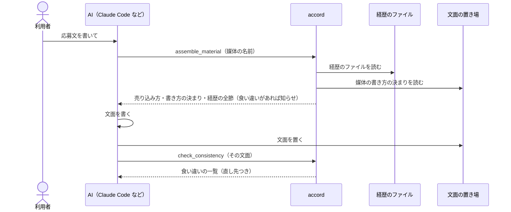
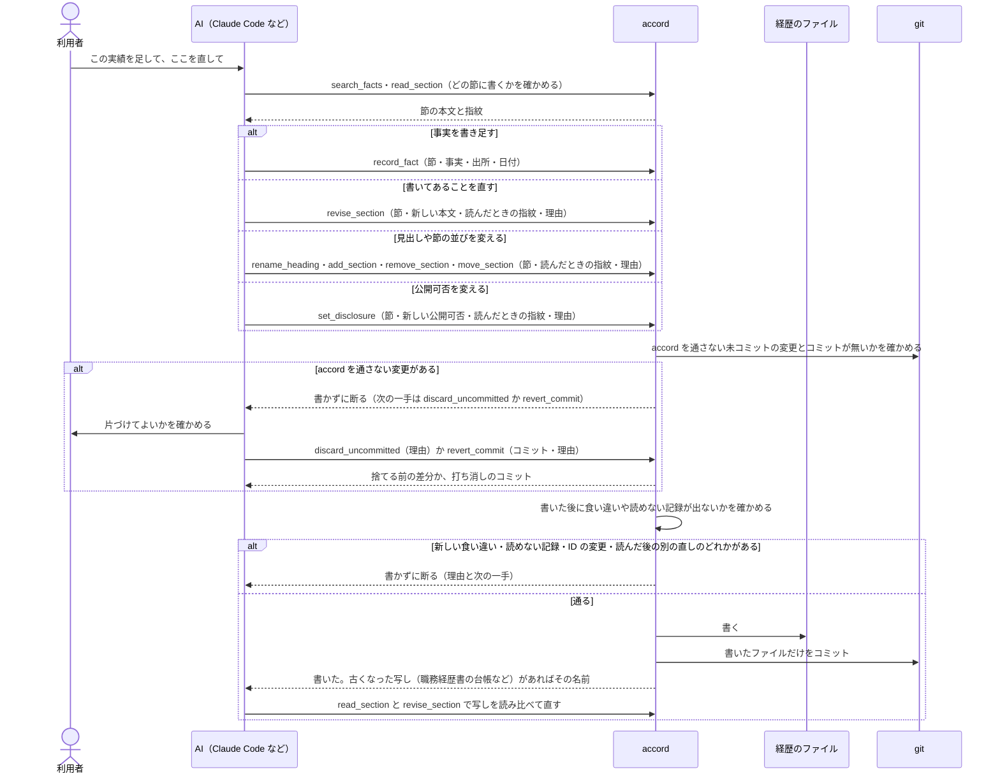
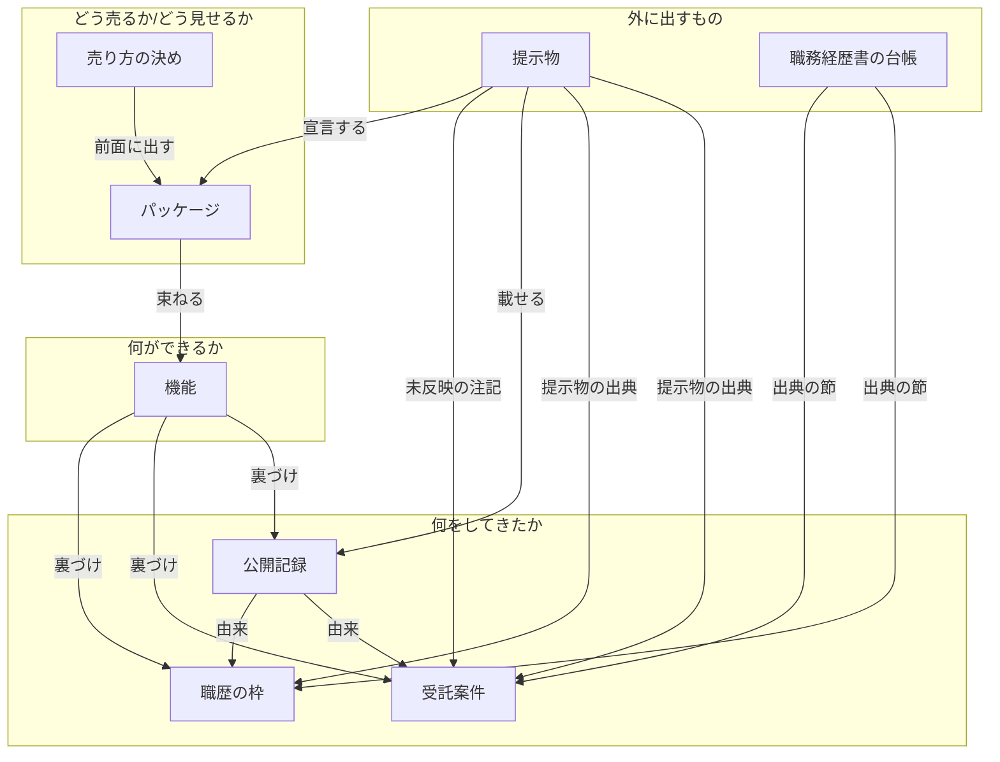

# accord

accord は、職務経歴書やプロフィールを AI と一緒に作るときに、その元になる経歴の記録と、そこから作る文書とを食い違わせないための、手元で動く MCP サーバーです。

フリーランスの案件や転職に応募するとき、職務経歴書は 1 通あれば足りると思いがちです。しかし、エンジニアとして応募するときと、プロジェクトマネージャとして応募するときでは、同じ経歴でも前面に出す部分や並べ方が違います。accord は、今回はどの側面で経歴をまとめるかを日付つきで記録し、そこから作る文書に、経歴に無い実績や古い売り文句が混ざっていないかを、出す前に確かめます。よい職務経歴書を書くためのプロンプトやエージェントではありません。

> **English:** One résumé rarely fits every application: applying as an engineer and applying as a project manager call for different parts of the same history, in a different order. accord is a local MCP server that keeps the underlying career record consistent while you build résumés and profiles with an AI. It is not a prompt or an agent for writing good résumés. It records which facet you are presenting now, and catches unsupported claims and stale pitches before they go out. Run it with `uv sync`, `uv run pytest`, `uv run accord --list`. The rest of this document is written in Japanese.

## 何をする道具か

経歴の元データは、3 種類の Markdown に分けて持ちます。

- 何ができるか（スキルの一覧）
- 何をしてきたか（職歴や案件の実績）
- どう売るか/どう見せるか（スキルをどう組み合わせて、誰向けに何を前面に出すか。この組み合わせを、この README ではパッケージと呼びます）

困るのは、売り込み方（いまどの側面を前面に出すか。ツール名では positioning）を変えたときです。「今月からプロジェクトマネージャの仕事を前面に出す」と決めても、その決定は会話の中で終わってどこにも残りません。結果として、パッケージの説明が 1 か月前のまま放置されたり、もう前面に出していないパッケージを名乗ったプロフィールが何枚も残ったりします。ルールとしては書いてあるのに、文章を書くその瞬間には思い出せません。

accord は、そのルールを「読んで覚えておくもの」から「書く瞬間に返ってくるもの」に変えます。文章そのものは書きません。書くのは人か AI で、accord がするのは材料を渡すことと、食い違いをその場で止めることです。使い方は 2 通りで、Claude などの AI から MCP 経由で呼ぶか、自分で Python から呼んで手元のファイルを検査します。

ツールの引数や戻り値に出てくる ID は、経歴の項目 1 つ 1 つに付ける短い名前です（詳しくは下の「データの型とルール」）。

| ツール | 何をするか |
|---|---|
| `get_positioning` | いまの売り込み方（何を前面に出しているか）を返す。まだ記録が無ければ「先に記録してください」と返す |
| `assemble_material` | 応募文・プロフィール・職務経歴書を書く前に 1 回呼ぶ。媒体（転職サイトやマッチングサービス）か、媒体ではない書く先（会社のホームページなど、`vocabulary.md` に書いた語）向けの文章を書くための材料をまとめて返す。中身は、いまの売り込み方、前面に出すパッケージの説明、その根拠になる実績の本文、その媒体の書き方の決まり（文字数など）、使わないと決めた言い回し、そして経歴のファイルの節すべて。公開できない実績は下の節ごと除き、除いたことを知らせる |
| `record_positioning` | 「今日から何を前面に出すか」を日付つきで記録する。必須の項目が欠けていれば、欠けた項目と書き方の例を返して書き込まない |
| `register_capability` | できることの一覧に 1 行足す。ID が形式に合わないか既に使われているか、根拠にした実績や公開記録の ID が実在しなければ、近い候補を返して書き込まない。分類が `vocabulary.md` に無い語のときも同じで、既にある行に `vocabulary.md` に無い分類が残っていれば検査でも挙げる |
| `register_public_record` | 公開記録（登壇・記事・リポジトリなど、外から確かめられる成果物）を 1 件記録する。必須の項目が欠けていたり、ID が形式に合わないか既に使われていたり、種類や役割が `vocabulary.md` に無い語だったり、元になった仕事の ID が実在しなければ、書き込まずに次の一手を返す |
| `revise_package` | パッケージ（スキルの組み合わせ）の説明を更新し、更新日を進める。一覧に無いスキルの ID を組み合わせに入れると、近いものを候補として返して書き込まない |
| `check_consistency` | 全ファイルをルールに照らし、食い違いを「どのファイルのどこを、何に合わせるか」つきで一覧にする |
| `list_sections` | 経歴の元データのファイルの節（見出し 1 つとその本文）を一覧にする。ファイルの名前、見出しの道筋（上の見出しからその節までを「 > 」でつないだもの）、本文の指紋（中身から作る 8 桁の値）、字数を返す |
| `read_section` | 節を 1 つ、ID か見出しの道筋で読み、本文と指紋を返す |
| `search_facts` | 語を含む行を、ファイルの名前と見出しの道筋つきで返す。全角と半角、大文字と小文字の違いは同じに扱い、50 件で切って総数を添える |
| `record_fact` | 実績や経歴の事実を書き足すときに呼ぶ。経歴のファイルの節 1 つの末尾に「- 事実（日付、出所: 確かめた先）」の 1 行を足す。足す行が「公開可否: …」のように項目の書き方になっていて、ID や公開可否の値が変わるなら書かない |
| `revise_section` | 節 1 つの本文を書き換える。どのファイルの節も書ける（できることの一覧・公開記録・パッケージ・売り込み方の記録の既にある行も、これで直す）。読んだときの指紋を渡させ、読んだ後に誰かが直していれば書かない。見出しと下の節は変えず、ID の行も変えさせない。公開可否の行を足す・消す・並べ替える・値を変えるときは、書いた後の公開可否の行の値の並びを `disclosures` に申告させ、実際と合えば書いて、変わる前と後の公開可否の行を返り値とコミットの説明に残す（申告が無いか合わなければ書かない）。公開可否の行を 2 行以上持つ節では、公開可否の行の無い項目を増やせない |
| `rename_heading` | 節の見出しの文字だけを変える。見出しの深さ・本文・下の節は変えない |
| `add_section` | 親の節（`parent`）の下に、1 段深い節を 1 つ足す。既定では親の下の節の末尾に、前に置く節（`before`）を渡せばその直前に置く（新しい順に並べる職歴のため）。親を渡さずにファイルの名前（`file`）を渡すと、そのファイルにいちばん上の深さの節を足す。本文に見出しの行は書けず、下の節は操作を重ねて作る |
| `remove_section` | 節の見出しと本文を消す。下の節を持つ節は消さない（先に下の節を消す） |
| `move_section` | 節を下の節ごと、別の親の節（`new_parent`）の下へ動かす。見出しの深さは新しい親に合わせてずらし、本文は 1 文字も変えない。同じ親の中の並べ替えにも使う。新しい親を渡さなければ、いちばん上の深さの節として動かす（いちばん上の節どうしの並べ替えもこれで行う）。ファイルをまたいでは動かせない |
| `set_disclosure` | ID を持つ節の公開可否（外に出してよいか）を変える。公開可否の行を 2 行以上持つ節では、何行目か（`line`、1 始まり）を渡してその行だけを変える（渡さなければ書かずに、いまの行を番号つきで返す）。「公開不可」から外すと、文面の材料に新しく出ることと、元の値・新しい値・理由を返す |
| `export_source` | 経歴の元データのファイルを 1 つの Markdown につないで、引数 `path` で渡した書き出し先に書く（別の場所に貼り付けて使うため。経歴の元データの置き場の中は指せない）。返すのはファイルの名前と字数だけ |
| `add_term` | `vocabulary.md` の種類（媒体・決めの適用先・機能の分類・パッケージの仮説の状態・公開記録の種類・公開記録の役割）の節の末尾に、語を 1 行足す。その種類に既にある語、空の語、改行を含む語は足さずに、いまの語の一覧を返す |
| `remove_term` | `vocabulary.md` の種類の節から語を消す。経歴の元データのどこかの節がその語を使っていれば（売り込み方の記録の適用範囲、スキルの分類の見出し、パッケージの状態、公開記録の種類と役割）、消さずに、使っている節を返す。語を直すときは、新しい語を足し、使っている節を `revise_section` で直してから、古い語を消す |
| `revert_commit` | 経歴の元データの置き場の履歴のコミット 1 件を、打ち消すコミットを 1 件足して取り消す（accord が書いたコミットも、accord を通さずに入ったコミットも）。後のコミットとぶつかるときと、取り消した後に新しい食い違いが出るときは、何も変えずに断る。`migrate_data` のコミットとそれより前は取り消さない |
| `discard_uncommitted` | 経歴の元データの置き場の、accord を通さない未コミットの変更を捨て、最後のコミットの状態に戻す。捨てる前の差分を返すので、頼まれた直しが入っていれば accord の操作でやり直せる |
| `migrate_data` | 前の版の accord の設定ファイル（`accord.toml`）を持つ経歴の元データの置き場を、accord の形（`vocabulary.md` を持つ形）にする。引数は無い。設定ファイルに書いた置き場と読み方が accord の形と同じことを確かめ（違えば違う項目と accord の形の値を返して何もしない）、設定ファイルに書いた言葉（媒体の名前や分類の語）から `vocabulary.md` を作り、設定ファイルを消し、その 2 つを 1 件のコミットにする。この操作を呼ぶまで、ほかのツールはどれもこの操作を指して断る。もう移行した置き場では断る |
| 資源 `accord://ontology` | データの型とルールの定義を、AI が読める形で返す。AI がセッションの最初に読んで前提を揃えるためのもので、利用者が何かする必要はない |

書き込む 16 のツールは、ルールに通った入力だけを書き、通らない入力は書かずに「次に何をすればよいか」を返します。経歴の元データのファイルは、人も AI も直接開いて直しません。中身を足す・直す・見出しを変える・節を足す・消す・動かす・公開可否を変える、のどれも、このツールで行います。自分の言葉（`vocabulary.md`）を変えること、書き込みを取り消すこと、accord を通さずに入った変更を片づけることも、ツールで行います。節を書き換えるツールと、見出しや節の並びや公開可否を変える 5 つのツールと、事実を書き足すツールは、書いた後のファイルに、書く前に無かった食い違いか、必須の項目が欠けて読めない記録が出るなら書きません（ただし、職務経歴書の台帳のような写しが古くなったことは止める理由にせず、読み比べる写しとして返します）。書き込むツールはどれも、変えたファイルをいつも git の 1 件のコミットに残します。読むだけのツールと検査は、経歴の元データのファイルを一切変えません。

読むツール（`get_positioning`・`assemble_material`・`list_sections`・`read_section`・`search_facts`・`export_source`）は、ファイルが食い違った状態になっていれば（accord を使い始める前から食い違っていたときなど）、戻り値の `consistency_notice` に食い違いの件数と直し先を載せます。経歴の元データの置き場に accord を通さない未コミットの変更か、accord を通さずに入ったコミットがあるときも、その件数と、片づけるツール（`discard_uncommitted` か `revert_commit`）の名前を同じところに載せます。検査は、前回からファイルの中身が変わったときだけ走らせ直します。どの戻り値にも、経歴の元データの置き場の絶対パスは入れません。AI のセッションに置き場を教えず、ファイルを直接開かずに accord の操作だけで読み書きさせるためです。

## 動くとこうなる

AI が文面を書くときは、accord に材料をまとめて頼み、書いた文面を出す前に検査を呼びます。



利用者が経歴の書き足しや直し、見出しや節の並べ替え、公開可否の変更を頼むときも、AI はファイルを直接開かず、accord の操作で書きます。



同梱の架空のサンプルデータ（`samples/`）のプロフィール 1 枚を、わざと古いパッケージ名を名乗った状態にして検査を呼ぶと、次の 1 件が返ります。出力の文は正本のファイルで使う短い呼び名で書かれていて、「看板」は前面に出しているパッケージ、「束」はパッケージ、「提示物」はプロフィールなどの文章のことです。

```json
{
  "constraint": "提示物の宣言と看板の一致",
  "file": "tsukikusa/profile.md",
  "location": "「宣言する束」の行",
  "expected": "いまの看板は「requirements-and-progress（要件定義と進行管理）」（2026-09-10 の決め・適用範囲 全体）で、この文面は「data-platform-setup（データの置き場づくり）」を名乗っている。宣言する束を看板の ID に書き換える。この文面だけ合わせない理由があるなら、決めの「例外」欄にこのファイル名と理由を書く。",
  "candidates": ["requirements-and-progress"]
}
```

書き込みを断るときも同じ形で、断った理由と、次に呼ぶ操作・欠けた項目・書き方の例が返ります。

Python から直接呼ぶなら次の形です。

```python
from pathlib import Path
from accord.vocabulary.settings import load_settings
from accord.services.consistency import ConsistencyService

settings = load_settings(Path("path/to/your/accord_data"), Path("path/to/your/outreach"))
report = ConsistencyService(settings).inspect()   # 範囲を省くと全体
for v in report.violations:
    print(v.constraint, v.file, v.expected)
```

## 動かしてみる

Python 3.12 以上と [uv](https://docs.astral.sh/uv/) が必要です。架空の人物と架空の案件で作ったサンプルデータを `samples/data/`（経歴の元データ）と `samples/presentations/`（文面）に同梱しています。

```
uv sync                # 依存パッケージを入れる
uv run pytest          # テストが通ることを確かめる
uv run accord --list   # ツール 23 個と資源 1 つの名前を表示する
```

サンプルで MCP サーバーを起動するには、経歴の元データを git のリポジトリにした写しを作ってから、その場所を `--data` で渡します（accord は経歴の元データの置き場が git のリポジトリの根であることを求め、書き込むたびにコミットします）。

```
cp -R samples/data /tmp/accord_sample && git -C /tmp/accord_sample init -q && git -C /tmp/accord_sample add -A && git -C /tmp/accord_sample commit -qm first
uv run accord --data /tmp/accord_sample --presentations samples/presentations
```

`uv run accord --data …` を実行すると、標準入出力で MCP サーバーとして起動します。起動時に全ファイルを検査し、食い違いと断りの件数を標準エラーに 1 行書きます（食い違いがあっても起動は続けます）。それ以外は画面に何も出ませんが、それで正常です（AI 側からの接続を待っています）。ネットワークは使いません。

## 自分のデータで使う

accord は設定ファイルを読みません。起動時に渡すのは 2 つの置き場です。`--data` に経歴の元データの置き場（git のリポジトリの根）を、`--presentations` に文面（プロフィールなど）と媒体ごとの書き方の決まりのファイルの置き場を渡します（`--presentations` を省くと文面を 0 件として読みます）。経歴の元データの置き場には、決まった名前の 7 つのファイルと、自分の言葉（媒体の名前、スキルの分類、パッケージの状態を表す語。たとえば「仮説のみ・検証中・実績あり」）を書いた `vocabulary.md` を置きます。ファイルの名前と書き方（accord の形）は 1 通りに決まっていて、`docs/data-format.md` に書いてあります。`samples/data/` を写して書き換えるのが早道です。

起動のしかたは 2 通りあります。**手元に置いた accord をそのまま動かす**なら、次の形です。`--project` で指した場所のソースが毎回そのまま動くので、accord のコードを直したら次の起動から反映されます。手元で直しながら使うなら、こちらを選んでください。

```
uv run --project /path/to/accord accord --data /path/to/your/accord_data --presentations /path/to/your/outreach
```

**版を固定して入れて使う**なら、次の形です。

```
uvx --from /path/to/accord accord --data /path/to/your/accord_data --presentations /path/to/your/outreach
```

こちらには落とし穴があります。`uvx` は指したパスから組み立てた環境を version（`pyproject.toml` に書いた版番号）で覚えるので、版を上げないかぎり、ソースを直しても前の版が動き続けます（`--refresh` や `--reinstall` を付けても戻りません）。

Claude Code から使うときは、プロジェクトの `.mcp.json` に次のように書きます。

```json
{
  "mcpServers": {
    "accord": {
      "command": "uv",
      "args": ["run", "--project", "/path/to/accord", "accord", "--data", "/path/to/your/accord_data", "--presentations", "/path/to/your/outreach"]
    }
  }
}
```

Markdown の形はサンプルを見るのが早く、たとえば売り込み方の記録は次の形です。

```markdown
## 2026-09-10 見本の決め

- 日付: 2026-09-10
- 適用範囲: 全体
- 前面に出す束: requirements-and-progress
- 根拠: 直近 3 件の引き合いが、作る前の整理と、決まったことを進める役の不在に集中していたため。
- 例外: なし
```

`vocabulary.md` には、種類ごとの節に語を 1 行ずつ書きます。種類は 6 つです。

| 種類 | 何を決めるか |
|---|---|
| 媒体 | 媒体の名前。売り込み方の記録の適用範囲と、文面の宛先に使う。文面は `--presentations` の下の、媒体と同じ名前のディレクトリから読む |
| 決めの適用先 | 媒体ではない書く先の語（例「会社のホームページ」）。売り込み方の記録と材料の取り出しが、媒体の名前と同じように受け付ける。語が無くてもよい |
| 機能の分類 | 機能の台帳の節の名前 |
| パッケージの仮説の状態 | パッケージの状態を表す語 |
| 公開記録の種類 | 公開記録（登壇・記事・リポジトリなど）の種類の語 |
| 公開記録の役割 | 公開記録で自分が何だったかを表す語 |

書き込むツールは、書いたファイルを、書き込み 1 件につき git の 1 件のコミットに残します。コミットの説明には、ツールの名前を示す行（`Accord-Operation: <ツールの名前>`）が入ります。経歴の元データの置き場のどこかに accord を通さない変更（まだコミットされていない変更）があるか、`migrate_data` のコミット（無ければ最初のコミット）より後に、ツールの名前を示す行を持たないコミット（accord を通さずに入ったコミット）があれば、書かずにそのことを返し、`discard_uncommitted` か `revert_commit` を次の一手に指します。`revert_commit` の打ち消しのコミットには、打ち消したコミットを示す行（`Accord-Reverts: <コミットの長い識別子>`）が入り、打ち消したコミットはそれ以後数えません。`export_source` は、書き出し先のファイルのパスを引数で受けます（経歴の元データの置き場の中は指せません）。

自分の Markdown の書き方が accord の形と違うときは、accord の形に変換してから使います。読み方を変える設定はありません。

前の版の accord を使っていて、経歴の元データの置き場に設定ファイル `accord.toml` があり `vocabulary.md` が無いときは、新しい起動の形（`--data` と `--presentations`）で起動してから、`migrate_data` を 1 回呼びます。設定ファイルに書いた置き場と読み方が accord の形と同じなら、設定ファイルに書いた言葉から `vocabulary.md` ができ、設定ファイルは消え、そのことが 1 件のコミットに残ります（それより前の状態は、その前のコミットとして残ります）。呼ぶまでは、ほかのツールはどれも `migrate_data` を指して断ります。

思ったとおりの結果が出ないときは、`check_consistency` の戻り値の先頭（`provenance`）を見てください。読んだ語彙のファイルの名前（経歴の元データの置き場の名前と `vocabulary.md`）、いま動いているソースの置き場と版が出るので、古いままの accord が動いていないかをその場で見分けられます。

## データの型とルール

accord が扱うデータの種類（型）と、型どうしのつながり（関係）と、守らせる決まり（ルール）は、`src/accord/ontology.yaml` という 1 つのファイルにまとめて定めてあります。中身は、型 8 つ、関係 9 種類、ルール 19 つです。関係のうち「裏づけ」は指す先の型が 3 つ（職歴の枠と受託案件と公開記録）、「由来」「出典の節」「提示物の出典」は 2 つずつ（職歴の枠と受託案件）あるので、下の図では矢印 14 本になります。Python の型のコードはこのファイルから自動生成し、資源 `accord://ontology` はこのファイルの中身を返します。この節の説明と定義のファイルがずれていないことは、テストで確かめています。



四角が型、矢印が関係です（同じ図を画像にしたものが `docs/ontology.svg` にあります。上の図が描画されない環境ではそちらを見てください）。四角に書いた名前は、ツールの戻り値や検査の結果にそのまま出てきます。矢印は一方向で、逆向き、つまり職歴や案件の側に「これはあのパッケージで使っている」と書き足すことはしません（これがルール「逆参照を書かない」）。下の表の 3 列目は、同梱のサンプルデータで対応するファイルです。自分のデータでも、ファイルの名前と置き場は同じです（accord の形。`docs/data-format.md`）。

| 型（ツールの出力に出る名前） | 何のこと | サンプルのファイル |
|---|---|---|
| 売り方の決め | いま何を前面に出して売るかを、日付つきで 1 件ずつ書き足す記録。この README で「売り込み方」と呼んでいるものです。 | `samples/data/product/positioning.md` |
| パッケージ | 機能をいくつか組み合わせて、誰に売るかまで決めた売り物の単位。プロフィールや応募文が名乗るのは、この名前です。 | `samples/data/product/packages.md` |
| 機能 | 提供できる仕事 1 つ。この README で「スキル」「できること」と呼んでいるもので、「これができる」と言える根拠の節を必ず持ちます。 | `samples/data/product/features.md` |
| 職歴の枠 | 会社 1 社ぶん、またはフリーランス 1 期ぶんの職歴。 | `samples/data/career_master.md` |
| 受託案件 | クライアント 1 社ぶんの仕事、または複数の案件にまたがる 1 つの話題。職歴の枠と並ぶ、実績の側のファイルです。 | `samples/data/career_master.md` |
| 公開記録 | 外から確かめられる公開の成果物 1 件。登壇・記事・書籍・リポジトリ・第三者の掲載など、本人の申告ではなく URL や現物で確かめられるものを、1 件ずつ書きます。ファイルが無ければ 0 件として読みます。 | `samples/data/public_records.md` |
| 提示物 | 転職サイトの画面や添付に貼る文面 1 枚。どのパッケージを名乗るかを本文に書きます。どの職歴の枠や受託案件から写したか（出典の節）も書けます。媒体ごとの下位ディレクトリに置きます。 | `samples/presentations/` |
| 職務経歴書の台帳 | 職務経歴書の元になるブロック 1 つ。ブロックは、案件 1 件ぶんと、在籍 1 社ぶんをまとめた在籍職歴の枠の 2 種類です。台帳全体は、このブロックの並びで持ちます。 | `samples/data/keirekisho/daicho.md` |

項目どうしをつなぐのは ID です。職歴・案件・公開記録・機能・パッケージの 5 つには、`- ID: teramina-delivery` のように短い ID を 1 行書き、ほかの項目からこれらを指すときは、見出しや名前ではなく、この ID を書きます。ID は人が付けます（見出しから自動では作りません）。決まりは 2 つだけで、**形**は英小文字・数字・ハイフンで 3〜40 字、先頭と末尾は英数字（正規表現なら `^[a-z0-9][a-z0-9-]{1,38}[a-z0-9]$`）。**重なり**は、5 つの種類をまたいで全部のファイルの中で 1 つの項目にしか付けられません。

1 つの欄に複数の ID を書くとき（機能の「裏づけの節」、パッケージの「束ねる機能」、台帳の在籍職歴の枠と提示物の「出典の節」）は、半角のスラッシュ「/」で区切ります。たとえば `teramina-delivery / yukinoha-quality` です。「・」や読点などほかの記号でつなぐと、つないだ全体が 1 つの値として読まれ、ID の形に合わないものとして拒否されます。この区切りは変えられません。

冒頭で「古い売り文句が混ざっていないかを、出す前に確かめます」と書いたうち、accord が機械で見るのは、写した後に正本の節が変わったか（ルール「写しの鮮度」）までです。写しの文言が正本と合っているかは文の意味の判断なので、accord は見ません。

ルール 19 つは次のとおりです。1 列目の名前は、検査の結果や、書き込みを断ったときの戻り値にそのまま出ます。3 列目は、そのルールがどこで効くかです。

| ルール（検査の出力に出る名前） | 見ているもの | どう現れるか |
|---|---|---|
| 決めの必須欄 | 売り方の決めに、日付・適用範囲・前面に出す束（前面に出すパッケージの ID）・根拠の 4 つの欄がそろっているか。 | 拒否（書き込まずに、欠けた欄の名前と書き方の例を返す） |
| パッケージ定義の鮮度 | パッケージの定義を最後に直した日が、適用される決めの日付より古くないか。 | 検出（検査の一覧に出る。読むときは警告） |
| 提示物の宣言と看板の一致 | 提示物が名乗っているパッケージが、決めで前面に出しているパッケージと一致するか。決めの「例外」欄に書いた提示物は見ない。 | 検出（検査の一覧に出る。読むときは警告） |
| ID の形式 | 職歴の枠・受託案件・公開記録・機能・パッケージの項目が自分に付ける ID が、決めた形（英小文字・数字・ハイフンで 3〜40 字、先頭と末尾は英数字）に合うか。ほかの項目を指す値（根拠・元になった仕事・写し元・未反映の事実）が形に合わないときは、その値を見るそれぞれのルールの名前で出る。 | 拒否（書き込まずに、形の直し方を返す） |
| ID の一意性 | 職歴の枠・受託案件・公開記録・機能・パッケージの項目が自分に付ける ID が、全部のファイルの中で 2 つ以上の項目に付いていないか。形に合わない ID は、形を直すまで重なりを見ない。 | 拒否（書き込まずに、同じ ID を持つ場所の両方を返す） |
| 裏づけ節名の実在 | 機能の根拠として書いた ID が、職歴の枠か受託案件か公開記録に実在するか。 | 拒否（書き込まずに、実在する ID のうち近いものを候補として返す。どの節のことかは、断りの文が表示名を添えて示す） |
| 束ねる機能名の一致 | パッケージが組み合わせる機能の ID が、機能の一覧にあるか。 | 拒否（書き込まずに、近い機能の候補と、先に `register_capability` を呼ぶことを返す） |
| 注記と出典の節の実在 | 提示物に書いた未反映の事実が指す ID と、職務経歴書の台帳の案件の写し元の節の ID が、受託案件に実在するか。台帳の在籍職歴の枠の写し元が職歴の枠に、提示物が宣言した写し元が職歴の枠か受託案件に実在するか。 | 検出（検査の一覧に出る。指す先の、実在する ID の候補を返す） |
| 出典と裏づけの節の公開可否 | 職務経歴書の台帳の写し元の節（案件は受託案件、在籍職歴の枠は職歴の枠）と、機能の根拠の節が、外に出してよい節か。未反映の事実が指す節は、文面の材料に写さないので見ない。 | 検出（検査の一覧に出る。外に出せない節は材料から落とし、落としたことを警告に書く。機能を登記したときも、外に出せない根拠の節を警告に書く） |
| 公開記録の必須欄 | 公開記録に、ID・名前・種類・日付・発行元か主催・役割の 6 つの欄がそろっているか。 | 拒否（書き込まずに、欠けた欄の名前と書き方の例を返す） |
| 公開記録の種類の語彙 | 公開記録の種類が、`vocabulary.md` の「公開記録の種類」にあるか。 | 拒否（書き込まずに、「公開記録の種類」の語を返す）。既にある記録の語が一覧に無いときは、検査でも挙げる |
| 公開記録の役割の語彙 | 公開記録の役割が、`vocabulary.md` の「公開記録の役割」にあるか。 | 拒否（書き込まずに、「公開記録の役割」の語を返す）。既にある記録の語が一覧に無いときは、検査でも挙げる |
| 機能の分類の語彙 | 機能の分類（機能の台帳の節の見出し）が、`vocabulary.md` の「機能の分類」にあるか。 | 拒否（書き込まずに、「機能の分類」の語を返す）。既にある行の分類が一覧に無いときは、検査でも挙げる |
| パッケージの仮説の状態の語彙 | パッケージの仮説の状態が、`vocabulary.md` の「パッケージの仮説の状態」にあるか。「検証中（引き合い 2 件）」のような末尾の括弧書きの注は落としてから照らす。 | 検出（検査の一覧に出る。「パッケージの仮説の状態」の語を返す）。節を書き換えるツールで一覧に無い語へ直そうとすると、書き込まずに断る |
| 決めの適用範囲の語彙 | 売り方の決めの適用範囲が、「全体」か、`vocabulary.md` の媒体の名前か媒体ではない書く先の語のどれかか。末尾の括弧書きの注は落としてから照らす。 | 検出（検査の一覧に出る。使える語の一覧を返す）。節を書き換えるツールで一覧に無い語へ直そうとすると、書き込まずに断る |
| 由来の節の実在 | 公開記録の元になった仕事として書いた ID が、職歴の枠か受託案件に実在するか。 | 拒否（書き込まずに、実在する ID のうち近いものを候補として返す。どの節のことかは、断りの文が表示名を添えて示す） |
| 提示物の URL と公開記録の一致 | 提示物の本文に貼った URL が、公開記録の一覧にあるか。同じ場所を指しているのに経路の書き方だけが違うものも見る。見るのは、公開記録と同じホストの URL だけ。 | 検出（検査の一覧に出る。ファイル名と、近い URL の候補を返す） |
| 写しの鮮度 | 職務経歴書の台帳のブロックと、写し元を宣言した提示物に控えた「出典の指紋」が、写し元の節のいまの本文から作った指紋と一致するか。指紋の控えが無い写しも、未確認の写しとして見る。写しの文言が正本と合っているかは見ない。 | 検出（検査の一覧に出る。本文が変わった写し元の節の ID と、読み比べた後に写しへ書く「出典の指紋」の行を返す） |
| 逆参照を書かない | 図の下にあるもの（職歴の枠・受託案件）が、上にあるもの（パッケージ・売り方の決め）を指す書き方をしていないか。 | 構造（実行時ではなく書き方で守る。モジュールの分け方とファイルの書き方で守るので、検査の違反の一覧には出ない） |

## 設計の考えと作り方

なぜこの作りにしたのかは [`docs/decisions/`](docs/decisions/)（決め 1 件ごとの記録）、いまの構造は [`ARCHITECTURE.md`](ARCHITECTURE.md) にあります。accord は、作者 1 人と AI（Claude Code）で作りました。

外から見える振る舞いを 1 件 1 文で書いた要件は [`docs/specs/`](docs/specs/) にあり、書き方と番号の決めはその案内にまとめてあります。要件とテストと実装の目印が番号で結ばれているかは `python3 tools/check_req_coverage.py` で確かめられ、同じ検査が変更のたびに自動でも走ります。検査を黙らせる印（lint の注記やテストを飛ばす印など）を置いた行に決めの記録の番号があり、その記録の 1 行が行のファイルと印を並べて名指ししているかを見る `python3 tools/check_bypass.py` も、変更のたびに走ります。許す理由が妥当かどうかは、この検査では見ません。

## ライセンス

MIT License。全文は `LICENSE` にあります。
